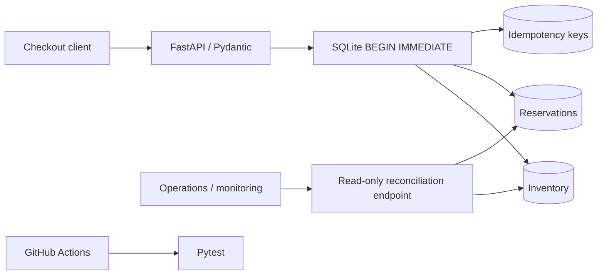
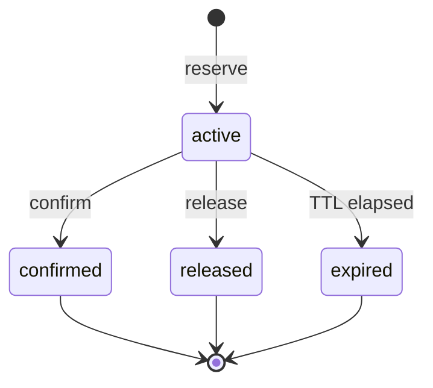

# 📦 Inventory Reservation API
**Transactional stock holds, safe retries, expiration, and inventory reconciliation**


[](https://github.com/nazirreally/inventory-reservation-api/actions/workflows/ci.yml)

> **The problem:** An e-commerce checkout needs to reserve a product while payment is pending. Two concurrent checkouts must never reserve the same final unit, client retries must not duplicate holds, and expired holds must return to availability.

## Architecture



## Technology stack

| Layer | Technology | Why |
|---|---|---|
| HTTP API | FastAPI, Pydantic | Typed requests, validation, OpenAPI docs |
| Transactions | SQLite WAL, `BEGIN IMMEDIATE` | Serializes concurrent writers on a single database |
| Idempotency | Unique key table | Retry safety for reservation creation |
| Reconciliation | SQL aggregation | Detects oversubscribed SKUs without changing data |
| Packaging | Docker, Compose | Reproducible single-service deployment |
| Quality | Pytest, GitHub Actions | Regression tests on Python 3.11 and 3.12 |

## Implemented capabilities

- **Atomic reservation:** a write transaction checks available units and inserts the hold.
- **Retry safety:** repeated requests with the same idempotency key return the original reservation.
- **Hold expiration:** availability ignores expired holds; write operations also mark them expired.
- **Confirmation:** reduces physical stock once and transitions a reservation to confirmed.
- **Release:** returns unconfirmed held units to availability.
- **Inventory protection:** rejects stock updates below currently active holds.
- **Operational reconciliation:** reports per-SKU stock, live holds, available units, and invariant violations.

## Run locally

Python 3.11+:

```bash
python -m venv .venv
# Windows PowerShell: .venv\Scripts\Activate.ps1
# Linux/macOS: source .venv/bin/activate
pip install -r requirements-dev.txt
pytest -q
uvicorn app.main:app --reload
```

Visit **http://127.0.0.1:8000/docs** for interactive OpenAPI documentation.

Alternatively, run with Docker:

```bash
docker compose up --build
```

The Compose volume persists SQLite data between restarts.

## Reproducible demo

```bash
curl -X PUT http://localhost:8000/inventory \
  -H 'Content-Type: application/json' \
  -d '{"sku":"coffee","stock":10}'

curl -X POST http://localhost:8000/reservations \
  -H 'Content-Type: application/json' \
  -H 'Idempotency-Key: checkout-1001' \
  -d '{"sku":"coffee","quantity":2,"ttl_seconds":900}'

curl http://localhost:8000/inventory/coffee
curl http://localhost:8000/health/inventory
```

The available stock after the hold is **8**. The reconciliation endpoint reports stock 10, held 2, available 8, and no oversubscription. Confirm or release the reservation using its returned ID.

## API reference

| Method | Path | Behavior |
|---|---|---|
| `PUT` | `/inventory` | Create/update physical stock |
| `GET` | `/inventory/{sku}` | Get available stock |
| `POST` | `/reservations` | Create idempotent hold |
| `POST` | `/reservations/{id}/confirm` | Confirm and deduct stock once |
| `POST` | `/reservations/{id}/release` | Release an active hold |
| `GET` | `/health/inventory` | Read-only per-SKU reconciliation |

### Reservation lifecycle



## Repository structure

```text
app/
  main.py             FastAPI endpoints, transactional lifecycle
  audit.py            Read-only stock reconciliation
tests/
  test_api.py         Reservation and expiry integration tests
  test_audit.py       Reconciliation unit tests
.github/workflows/
  ci.yml              Pytest matrix
Dockerfile
compose.yaml
requirements.txt
requirements-dev.txt
```

## Testing and verification

```bash
pytest -q
python -m compileall -q app
```

Five reconciliation unit tests were executed locally before publishing this upgrade. GitHub Actions is configured, but passing remote CI must be confirmed on the [Actions page](https://github.com/nazirreally/inventory-reservation-api/actions).

## Engineering trade-offs

1. **SQLite vs PostgreSQL:** WAL and immediate write locks provide an easy-to-run correctness demonstration; PostgreSQL would be preferable for horizontally scaled production workloads.
2. **Lazy expiry vs scheduler:** no background service is needed, but expired statuses are materialized only during certain writes; availability always uses expiration timestamps.
3. **Global idempotency keys:** sufficient for a single tenant; a production system should scope keys by tenant and request fingerprint, including TTL.
4. **Read-only reconciliation:** reports invariant violations but intentionally does not modify inventory.

## Security and limitations

This is a **portfolio reference implementation**, not an internet-facing production service. It has no authentication, tenant isolation, rate limiting, payment processing, distributed tracing, or authorization for stock edits and reconciliation. Deploy only in a trusted environment. The demo API and health endpoint expose inventory data.

## Roadmap

- PostgreSQL migration and concurrency stress tests
- Authenticated operator and checkout roles
- Structured logs, OpenTelemetry metrics and tracing
- Expiry sweeper and historical inventory audit ledger
- Contract tests and load-testing benchmarks

## License

MIT — see [LICENSE](LICENSE).
