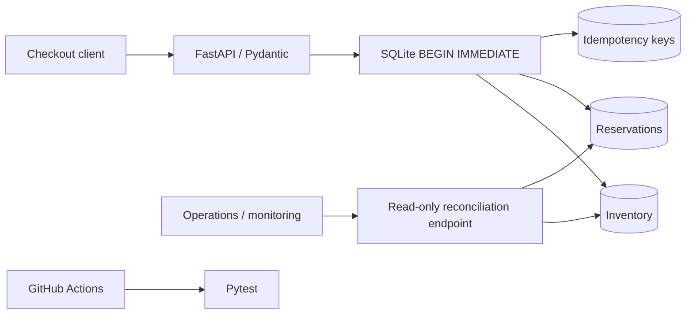
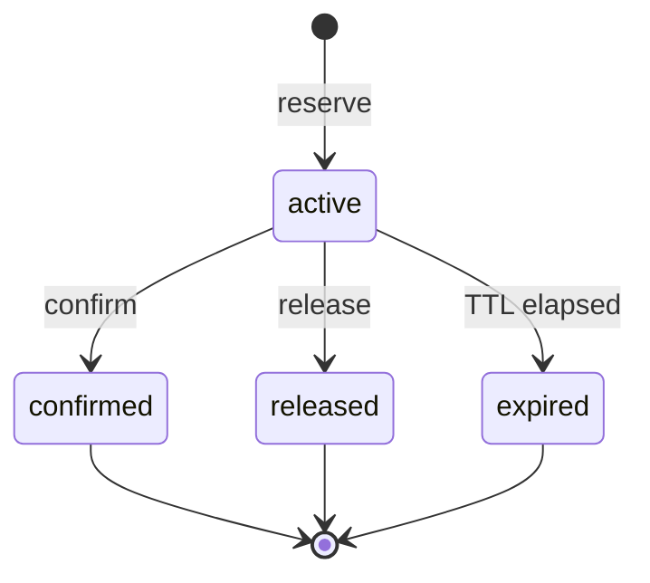

# 📦 Inventory Reservation API
**Transactional stock holds, safe retries, expiration, and inventory reconciliation**


[](https://github.com/nazirreally/inventory-reservation-api/actions/workflows/ci.yml)

> **The problem:** An e-commerce checkout needs to reserve a product while payment is pending. Two concurrent checkouts must never reserve the same final unit, client retries must not duplicate holds, and expired holds must return to availability.

## Architecture



## Technology stack

| Layer | Technology | Why |
|---|---|---|
| HTTP API | FastAPI, Pydantic | Typed requests, validation, OpenAPI docs |
| Transactions | SQLite WAL, `BEGIN IMMEDIATE` | Serializes concurrent writers on a single database |
| Idempotency | Unique key table | Retry safety for reservation creation |
| Reconciliation | SQL aggregation | Detects oversubscribed SKUs without changing data |
| Packaging | Docker, Compose | Reproducible single-service deployment |
| Quality | Pytest, GitHub Actions | Regression tests on Python 3.11 and 3.12 |

## Implemented capabilities

- **Atomic reservation:** a write transaction checks available units and inserts the hold.
- **Retry safety:** repeated requests with the same idempotency key return the original reservation only when SKU, quantity **and hold TTL** match. Changed requests return HTTP 409.
- **Hold expiration:** availability ignores expired holds; write operations also mark them expired.
- **Confirmation:** reduces physical stock once and transitions a reservation to confirmed.
- **Release:** returns unconfirmed held units to availability; an already-expired hold cannot be released as if it were active.
- **Inventory protection:** rejects stock updates below currently active holds.
- **Atomic inventory batch reconciliation:** updates up to 100 distinct SKUs together, rejecting the entire request when any proposed stock value would undercut live holds. No partial writes.
- **Operational reconciliation:** reports per-SKU stock, live holds, available units, and invariant violations.
- **Multi-SKU cart preflight:** checks up to 100 requested lines in one consistent SQLite read snapshot, aggregates duplicate SKUs, reports missing SKUs without failing the entire request, and explicitly does not reserve stock.
- **Reservation status lookup:** read a hold or its terminal state by ID; expired active holds are shown as expired without changing the database.

## Run locally

Python 3.11+:

```bash
python -m venv .venv
# Windows PowerShell: .venv\Scripts\Activate.ps1
# Linux/macOS: source .venv/bin/activate
pip install -r requirements-dev.txt
pytest -q
uvicorn app.main:app --reload
```

Visit **http://127.0.0.1:8000/docs** for interactive OpenAPI documentation.

Alternatively, run with Docker:

```bash
docker compose up --build
```

The Compose volume persists SQLite data between restarts.

## Reproducible demo

```bash
curl -X PUT http://localhost:8000/inventory \
  -H 'Content-Type: application/json' \
  -d '{"sku":"coffee","stock":10}'

curl -X POST http://localhost:8000/reservations \
  -H 'Content-Type: application/json' \
  -H 'Idempotency-Key: checkout-1001' \
  -d '{"sku":"coffee","quantity":2,"ttl_seconds":900}'

curl http://localhost:8000/inventory/coffee
# Substitute the ID returned by POST /reservations:
curl http://localhost:8000/reservations/REPLACE_WITH_RESERVATION_ID
curl http://localhost:8000/health/inventory
```

The available stock after the hold is **8**. The reconciliation endpoint reports stock 10, held 2, available 8, and no oversubscription. Confirm or release the reservation using its returned ID.

## Cart preflight example

Before attempting payment, a checkout can request an **advisory snapshot** of all required products:

```bash
curl -X POST http://localhost:8000/inventory/availability \\
  -H 'Content-Type: application/json' \\
  -d '{"items":[{"sku":"coffee","quantity":2},{"sku":"coffee","quantity":1},{"sku":"tea","quantity":1}]}'
```

The response includes `can_fulfill`, an `as_of` Unix timestamp and one row per distinct SKU with `requested`, `available`, `sufficient` and `exists`. Duplicate cart lines are summed, so the example requests **3 coffee** and **1 tea**. Unknown SKUs report `exists:false` and `available:0`. The request allows 1–100 lines, and each quantity must be positive. **This endpoint does not hold inventory**: another checkout can consume units after the snapshot. Use the atomic reservation endpoint for an actual hold.

## API reference

| Method | Path | Behavior |
|---|---|---|
| `PUT` | `/inventory` | Create/update physical stock |
| `PUT` | `/inventory/batch` | Atomically update 1–100 distinct SKUs, rejecting unsafe stock changes |
| `GET` | `/inventory/{sku}` | Get available stock |
| `POST` | `/inventory/availability` | Advisory multi-SKU cart availability snapshot (no reservation) |
| `POST` | `/reservations` | Create idempotent hold |
| `GET` | `/reservations/{id}` | Read reservation status, with effective expiration applied in the response |
| `POST` | `/reservations/{id}/confirm` | Confirm and deduct stock once |
| `POST` | `/reservations/{id}/release` | Release an active hold |
| `GET` | `/health/inventory` | Read-only per-SKU reconciliation |

### Reservation lifecycle



## Repository structure

```text
app/
  main.py             FastAPI endpoints, transactional lifecycle
  audit.py            Read-only stock reconciliation
tests/
  test_api.py         Reservation and expiry integration tests, status lookup
  test_audit.py       Reconciliation unit tests
  test_concurrency.py  Concurrent hold, confirm and release checks
.github/workflows/
  ci.yml              Pytest matrix
Dockerfile
compose.yaml
requirements.txt
requirements-dev.txt
```

## Concurrent correctness tests

The repository includes a file-backed SQLite contention suite using `ThreadPoolExecutor` and synchronized request starts. It verifies that 20 simultaneous checkouts for 5 units result in exactly 5 successful holds, 12 identical retries return one reservation, 10 simultaneous confirmations deduct stock only once, and 8 concurrent releases remain idempotent. These are correctness-focused contention checks, **not** throughput benchmarks or proof of distributed scalability.

```bash
pytest -q tests/test_api.py tests/test_concurrency.py
```

The GitHub Actions workflow runs the full test suite on Python 3.11 and 3.12, checks Python compilation, and builds the Docker image. The [20 November 2026 workflow run](https://github.com/nazirreally/inventory-reservation-api/actions/runs/44677807815) completed successfully. Earlier failed runs remain visible in the Actions history.

## Testing and verification

```bash
pytest -q
python -m compileall -q app
```

For ongoing status, refer to [GitHub Actions](https://github.com/nazirreally/inventory-reservation-api/actions). A successful local or CI run establishes test results for that revision, not production-readiness.

## Engineering trade-offs

1. **SQLite vs PostgreSQL:** WAL and immediate write locks provide an easy-to-run correctness demonstration; PostgreSQL would be preferable for horizontally scaled production workloads.
2. **Lazy expiry vs scheduler:** no background service is needed, but expired statuses are materialized only during certain writes; availability always uses expiration timestamps.
3. **Global idempotency keys:** SKU, quantity and TTL are compared on retry. A production system should scope keys by tenant, normalize request fingerprints, define key retention, and document replay semantics after expiry.
4. **Read-only reconciliation:** reports invariant violations but intentionally does not modify inventory.

## November 22, 2026 — reservation correctness hardening

This revision closes three lifecycle edge cases: (1) reusing an idempotency key with a different TTL now returns **409**, rather than silently replaying an incompatible hold; (2) reservation SKU inputs now share the stock-write SKU format and length contract; and (3) release requests against expired holds return **409**, rather than reporting a successful release. Four regression tests cover TTL mismatch, exact replay, invalid SKU, and expiry-versus-release behavior.

**Verification status:** The changes are committed and GitHub Actions is configured to run the test suite. The new revision has not been independently executed locally in this run; do not infer CI success until the latest run is green. See [Actions](https://github.com/nazirreally/inventory-reservation-api/actions).

## Security and limitations

This is a **portfolio reference implementation**, not an internet-facing production service. It has no authentication, tenant isolation, rate limiting, payment processing, distributed tracing, or authorization for stock edits and reconciliation. Deploy only in a trusted environment. The demo API and health endpoint expose inventory data.

## Roadmap

- PostgreSQL migration and concurrency stress tests
- Authenticated operator and checkout roles
- Structured logs, OpenTelemetry metrics and tracing
- Expiry sweeper and historical inventory audit ledger
- Contract tests and load-testing benchmarks

## License

MIT — see [LICENSE](LICENSE).

## November 22, 2026 — source recovery and status inspection

A source review found that `app/main.py` had a malformed Pydantic `ReserveInput.sku` pattern and an accidentally duplicated module tail. Both are now removed, restoring a single coherent FastAPI module. This is a correctness repair, not a new repository.

The API also implements `GET /reservations/{id}`, allowing a checkout client to inspect a hold's current effective state without triggering a database write. For an `active` reservation past its expiration timestamp, the response reports `expired`; lazy materialization of the persisted status still occurs on later writes. Unknown IDs return 404. Three integration tests cover active-to-confirmed lookup, expiry without writes, and unknown IDs.

**Verification for this revision:** Code and tests are committed. The updated full suite and GitHub Actions outcome have not yet been verified; consult the [Actions page](https://github.com/nazirreally/inventory-reservation-api/actions) for the latest workflow result. No claim of a green build is made for this commit.

**Tradeoff:** The read endpoint reveals reservation metadata to anyone who knows an ID. This portfolio demo is not suitable for a public deployment without authentication and tenant-scoped authorization.


## November 23, 2026 — import repair and multi-SKU preflight

A fresh source inspection found `ReserveInput` malformed in the repository: its SKU validation expression was unterminated, and the quantity field was absent. The model has been repaired with a validated SKU, positive quantity and bounded TTL. The new `POST /inventory/availability` endpoint provides consistent read-only cart availability, aggregates repeated SKU lines, handles missing products explicitly and never reserves stock. Four integration tests were added for duplicate lines, missing SKUs, invalid requests and expired holds.

**Verification:** Source, tests and documentation have been committed. Full pytest and CI outcomes for these commits are not yet verified; inspect [GitHub Actions](https://github.com/nazirreally/inventory-reservation-api/actions) before relying on this revision. This is a single-database portfolio demonstration, not a production checkout service.

## November 24, 2026 — transactional multi-SKU stock reconciliation

**Business problem.** Warehouse imports often deliver a stock count for several products at once. Updating one SKU at a time can leave a partially applied inventory snapshot if a later row conflicts with an active checkout reservation.

**Implemented:** `PUT /inventory/batch` accepts 1–100 stock records with the same SKU and nonnegative stock validation as the single-SKU endpoint. It rejects repeated SKUs with HTTP 422. A SQLite `BEGIN IMMEDIATE` transaction expires stale holds, validates *every* requested stock value against live reservations, and only then applies all updates. A single insufficient-stock conflict returns HTTP 409 and rolls back the entire batch, including any expiry materialization. This endpoint sets **absolute physical stock**; it does not add stock and is not an order or payment API.

```bash
curl -X PUT http://localhost:8000/inventory/batch \
  -H 'Content-Type: application/json' \
  -d '{"items":[{"sku":"coffee","stock":25},{"sku":"tea","stock":18}]}'
# {"updated":2,"items":[{"sku":"coffee","stock":25},{"sku":"tea","stock":18}]}
```

**Testing:** Five new integration tests cover successful updates, rollback when one SKU conflicts with a live hold, duplicate SKU rejection, malformed/boundary inputs, and expired holds. Run `pytest -q tests/test_api.py` and `pytest -q`. These tests have been committed but **were not executed in this run**, because the execution environment could not clone the repository. The GitHub Actions result for this revision is not verified; check [CI](https://github.com/nazirreally/inventory-reservation-api/actions).

**Tradeoffs:** A batch is limited to 100 items to bound SQLite write-lock duration; it is atomic only within one SQLite database, not across services. Requests are not authenticated, and there is no import job history or external warehouse synchronization. Future work: operator authentication, durable stock-adjustment audit ledger, and PostgreSQL-backed reconciliation.
